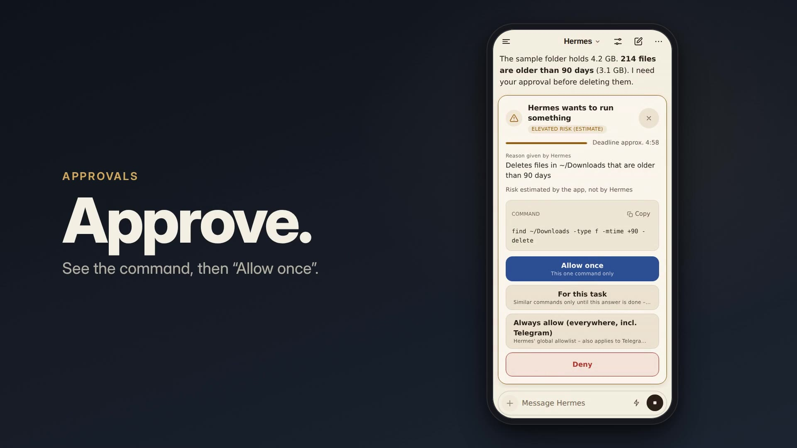
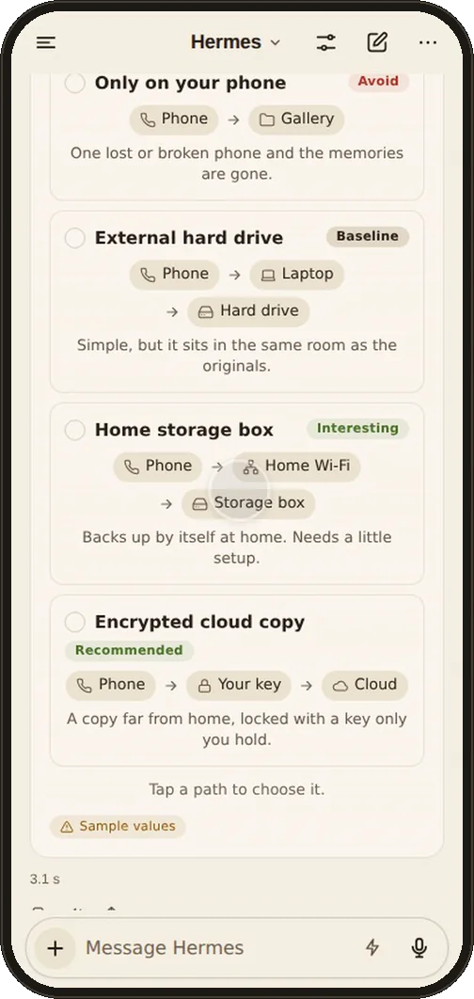
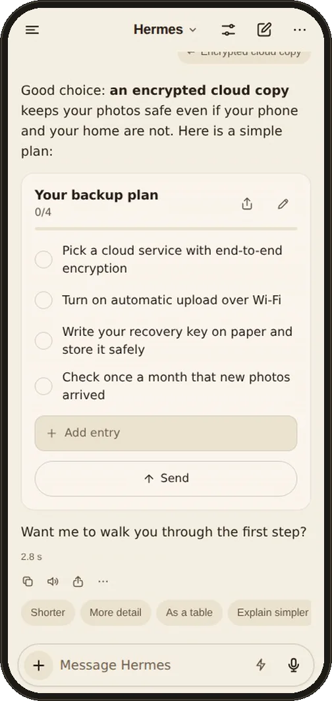
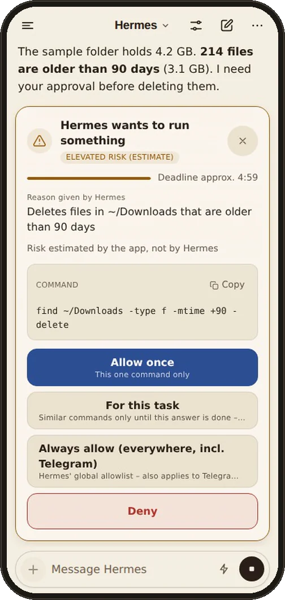
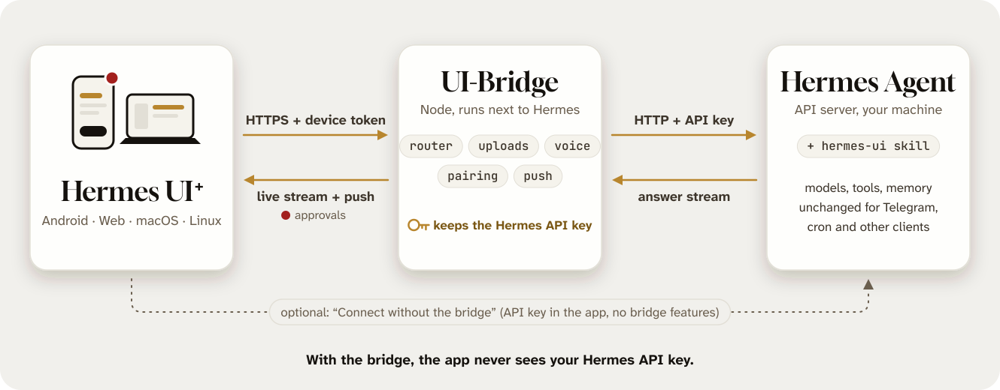

# Hermes Interactive UI+

**Don't just read your agent. Interact with it.**

[](https://hermesui.xyz)

Hermes Interactive UI+ (**Hermes UI+** on your home screen) is a mobile, web and desktop app for your own [Hermes Agent](https://github.com/NousResearch/hermes-agent). Hermes answers with things you can act on: tick a checklist, pick an option, compare products, fill in a form, rank, vote. Each tap goes back to Hermes as the next message, and the conversation continues from there. When Hermes wants to run a command, you approve or deny it from your phone; meanwhile you watch every tool step live, or leave the app while Hermes keeps working.


- **Who it is for:** people who already run Hermes Agent and talk to it through Telegram or the terminal today.
- **What you need:** your own Hermes Agent (v0.21 or newer) and a **small bridge** that you run next to it (`npx hermes-ui-plus-bridge setup`). There is no hosted service and no account. See [Quick start](#quick-start).
- **Where it runs:** Android (APK), web app (PWA, also on iPhone/iPad), macOS (signed and notarized) and Linux (alpha). Downloads: [GitHub Releases](https://github.com/robbyczgw-cla/hermes-ui-plus/releases).

> **Status: alpha (0.1).** Expect rough edges; see [Known limitations](#known-limitations-alpha). Hermes Interactive UI+ (Hermes Interactive UI Plus) is an **unofficial community client**. It is not affiliated with, endorsed by, or supported by Nous Research.


## Quick start

About 10 minutes if Hermes already runs. **Just looking?** Install the Android or desktop app and start the demo from its welcome screen: recorded answers, no Hermes needed.

### Before you start

- **Hermes Agent v0.21 or newer** on a machine you control. Tested with Hermes v0.22.0; see [Hermes compatibility](#hermes-compatibility).
- **Node.js 22+** on that machine, for the bridge (check with `node --version`). The Hermes installer brings its own private Node.js, which is not on your `PATH`, so `npx` may be missing. Distribution packages are often too old (Ubuntu 24.04's `nodejs` is version 18): install a current LTS from [nodejs.org](https://nodejs.org/en/download), the NodeSource packages or nvm. **Docker** works too, but there is no prebuilt image in 0.1: you build it from a checkout ([docs/SELF-HOSTING.md](docs/SELF-HOSTING.md#with-docker)).
- **A private network path** from your phone to that machine. **[Tailscale](https://tailscale.com) is strongly recommended** (HTTPS, nothing exposed to the internet). No Tailscale? For the Android app a LAN address over plain HTTP is enough for a test ([LAN only](docs/SELF-HOSTING.md#alternative-lan-only)); a first test of the web app in a browser on the bridge machine itself needs neither ([docs/WEB-APP.md](docs/WEB-APP.md#first-test-without-https)).

### 1. Turn on the Hermes API server

Once; skip if `grep API_SERVER ~/.hermes/.env` already shows both settings. Add two lines to `~/.hermes/.env`, then start the Hermes gateway, which serves the API:

```bash
printf 'API_SERVER_ENABLED=true\nAPI_SERVER_KEY=%s\n' "$(openssl rand -hex 32)" >> ~/.hermes/.env
hermes gateway install              # background service (systemd/launchd); in Docker or WSL: hermes gateway run
hermes gateway status
curl http://127.0.0.1:8642/health   # should answer {"status": "ok", ...}
```

If the gateway was already running, restart it (`hermes gateway restart`).

### 2. Set up the bridge

On the machine that runs Hermes:

```bash
npx hermes-ui-plus-bridge setup
```

The wizard checks Hermes (home directory, API server, version), installs the `hermes-ui` skill, offers Web Push, writes the bridge settings, installs a service (systemd, or launchd on macOS; inside a container it prints the start command instead), publishes the bridge on your tailnet with `tailscale serve`, and finally prints a **QR code and pair link**. Without Tailscale it prints no QR code; instead it tells you where to set the address your phone can reach (`BRIDGE_PUBLIC_URL`) and how to get a new pair link afterwards.

- By default the bridge is a pure pass-through to Hermes: no provider keys are asked for. Optional direct-provider extras (LLM router, chat titles, image search, voice) are opt-in with `setup --extras` and call providers from the bridge, outside Hermes; see [docs/BRIDGE.md](docs/BRIDGE.md#where-your-data-goes).
- Preview first: `npx hermes-ui-plus-bridge setup --dry-run`. Re-run the wizard any time to update; it changes things in place.
- It never edits Hermes' config without asking and never restarts Hermes. If the Hermes API server is off, it shows the exact config snippet and restart command.
- **Let an agent do it:** paste a ready-made prompt into Hermes (Telegram, CLI) or Claude Code / Codex: [docs/SETUP-WITH-AGENT.md](docs/SETUP-WITH-AGENT.md). The agent runs `setup --yes --json` and sends you the pair link.
- Docker, manual setup and LAN-only use: [docs/SELF-HOSTING.md](docs/SELF-HOSTING.md). The skill alone: [hermes-skill/INSTALL.md](hermes-skill/INSTALL.md).

### 3. Install the app and pair it

- **Android:** install the APK ([Install on Android](#install-on-android)), open the app and choose **Scan QR code**.
- **Web app (PWA), also iPhone and iPad:** unpack the web bundle next to the bridge and open the pair link: [docs/WEB-APP.md](docs/WEB-APP.md). On iPhone/iPad, **Add to Home Screen** afterwards; the native iOS app is not published yet.
- **macOS / Linux:** download the app from [GitHub Releases](https://github.com/robbyczgw-cla/hermes-ui-plus/releases) ([Platforms](#platforms)) and paste the pair link.

A QR code or pair link carries a **one-time pairing code**, not a token: the app exchanges it for its own revocable device token the first time it connects. The code works once and expires after one hour if unused. Never share a screenshot of a QR code. A new pair link at any time: `npx hermes-ui-plus-bridge devices add "Phone"`.

> **Warning: do not expose the bridge or the Hermes API server to the public internet.** Hermes can run terminal and file tools, and anyone with access can use them. Do not use port forwarding or `tailscale funnel`. Stay on your tailnet or your trusted LAN.

## Features

- **Act on answers instead of just reading them.** **48 native answer components**, 24 of them interactive: checklists you tick, choices and decisions you make, forms and calculators you fill in, products and places you compare, polls, rankings and scales, quizzes, flashcards and vocabulary trainers, timers, workouts, study plans, and **paths** (2-6 ways or variants with a verdict badge, optionally one to choose). Every check, vote, choice or slider value goes back to Hermes as the next message, so you pick the next step with a tap instead of typing it; the state is kept per conversation. The others present: tables, charts (bar, line, pie, radar, gauge, heatmap and more), stats, comparisons, steps, timelines, mind maps and **blocks** (an architecture at a glance: boxes in up to three columns with an optional shared base layer). Hermes picks the component; the count includes layout and text nodes, and sandboxed HTML widgets come on top.
- **Approvals.** When Hermes asks before running a command, you see the command, Hermes' reason and an estimated risk, and answer in the app: allow once, for this task, always, or deny. The web app (PWA) can also notify you through Web Push while it is closed. Android has no remote push in 0.1: no notification while the app is closed ([Known limitations](#known-limitations-alpha)).

| Choose a path | Tick a checklist | Approve a command |
|:-:|:-:|:-:|
|  |  |  |

- **Streaming chat** with Markdown, rendered progressively while Hermes writes, plus a tool-call timeline that shows what ran and how long it took. Switching between chats is instant (transcripts are cached and fetched ahead), you can press Send while attachments are still uploading (the message shows at once and the turn starts when the uploads are done), and the drawer loads older Hermes chats at its end, so older app chats are reachable on a new device. Settings → Chat → **Chats** chooses whether the drawer lists this app's chats from all your devices (default) or only those created on this device; nothing is deleted either way.
- **Router.** The UI-Bridge decides per message whether a plain answer or an interactive component fits best, so short questions stay short. It works rule-based out of the box and can use an LLM if you configure one.
- **Hermes profiles (bots).** If your Hermes has profiles (`hermes profile create <name>`: own model, memory and skills), each chat can talk to one of them: pick it in the model menu's "Bot" section. Session sync, approvals and push open the chat of the right bot. With the bridge the bots are listed automatically; without profiles nothing changes (no "Bot" section).
- **Schnellfrage (quick questions, ⚡).** One-off questions answered in about two seconds by a fast model of your Hermes, without the agent (no memory, tools or live data), in a local quick thread; "Mit Hermes weitermachen" hands the answer to a normal chat. Needs the optional Hermes plugin `hermes-ui-plus` ([docs/HERMES-PLUGIN.md](docs/HERMES-PLUGIN.md)); without it the ⚡ entry is simply not shown.
- **Slash commands** (`/new`, `/model`, `/reasoning`, `/retry`, `/stop`, `/approve`, `/skills`, `/usage`, `/export` and more) with a searchable palette, in English, German and Spanish.
- **Voice.** Dictation (tap to start and stop, or hold to talk; recording starts on touch-down) and read-aloud: on-device speech recognition and voices, speech providers configured on your bridge, or providers you add in the app with your own key. With "Read replies aloud automatically" on, reading starts with the first complete sentences while the answer is still streaming.
- **Images and files.** Attach photos and documents; images in answers carry their source. Product and place photos from Hermes' answers load through your bridge's image proxy without a tap; other unknown hosts are tap-to-load. Places, food and sights also get photos from Wikipedia. Product cards show a photo only when Hermes returns one or the bridge has an image search key (`setup --extras`, Serper or Brave); otherwise they show a neutral icon rather than a possibly wrong photo.
- **Sandboxed HTML widgets** for custom visuals, with no access to your data or device.
- **Multi-platform.** One codebase for Android, web (PWA), macOS and Linux (Tauri) and iOS. See [Platforms](#platforms) for what you can install today.
- **Local-first.** Conversations are stored on your device. No accounts, no telemetry.

## How it works

<picture>
  <source media="(prefers-color-scheme: dark)" srcset="docs/images/how-it-works-dark.svg">
  
</picture>

- **The app** talks only to your bridge, so it never sees your Hermes API key. "Connect without the bridge" in onboarding is optional: the app then uses the API key directly and has none of the bridge's features.
- **The UI-Bridge** (`bridge/`) is a small open-source Node service you run next to Hermes. It holds the API key, authenticates your devices, routes presentation, handles uploads, voice and push, and pairs new devices by QR code. Why it exists and how it is secured: [docs/BRIDGE.md](docs/BRIDGE.md).
- **The skill** (`hermes-skill/hermes-ui/`) teaches Hermes the answer protocol. It only loads for sessions from this app, so Telegram, cron and other clients are unaffected.

## Platforms

| Platform | How to get it | Status |
|---|---|---|
| **Android** | Signed APK from [GitHub Releases](https://github.com/robbyczgw-cla/hermes-ui-plus/releases), or add the repo to [Obtainium](https://obtainium.imranr.dev) for automatic updates | Available. No remote push in 0.1 (no notification while the app is closed, see [Known limitations](#known-limitations-alpha)). Settings → About shows the version and build number |
| **Web (PWA)** | Prebuilt bundle from [GitHub Releases](https://github.com/robbyczgw-cla/hermes-ui-plus/releases), served by your own bridge, installable to the home screen | Available, install guide: [docs/WEB-APP.md](docs/WEB-APP.md). The only place with Web Push |
| **macOS** | `hermes-ui-plus-<version>-macos-arm64.dmg` (+ `.sha256`) from [GitHub Releases](https://github.com/robbyczgw-cla/hermes-ui-plus/releases): native Tauri app for Apple Silicon (macOS 13+), Developer ID signed and notarized | Available, see [desktop/README.md](desktop/README.md) |
| **Linux** | AppImage or .deb (x86_64) from [GitHub Releases](https://github.com/robbyczgw-cla/hermes-ui-plus/releases), built on Ubuntu 22.04: needs glibc 2.35 or newer (Ubuntu 22.04+, Debian 12+); not signed, no auto-update | Alpha, see [desktop/README.md](desktop/README.md#linux-alpha) |
| **iOS** | Use the web app (PWA) for now | The native app is prepared for TestFlight / App Store (see [docs/IOS.md](docs/IOS.md)); not published yet |

**macOS app.** The same UI in a native shell: translucent sidebar and unified title bar, menu bar and keyboard shortcuts (new chat, search chats, find in chat, stop, switch chats), a native right-click menu on answers, dock badge for unread answers and a dock menu with recent chats, notifications for finished answers and approvals (with *Allow once* / *Deny* buttons, no need to open the window), open at login, a menu-bar-only mode, an optional Touch ID lock, and files by drag and drop, onto the dock icon or paste. Global shortcut: Option+Space. Notifications come from the running app (including while its window is closed); there is no push to a Mac that is off or has quit the app.

**Install the web app:** download `hermes-ui-plus-web-<version>.tar.gz`, unpack it on the bridge machine, run `npx hermes-ui-plus-bridge setup --web-dir <folder>` and open the pair link. Step by step: [docs/WEB-APP.md](docs/WEB-APP.md).

### Install on Android

The APK runs on **64-bit ARM (arm64-v8a) devices with Android 7.0 or newer**, which covers practically every current phone and tablet. There is no 32-bit or x86 build.

1. Download `hermes-ui-plus-<version>.apk` and `hermes-ui-plus-<version>.apk.sha256` from [GitHub Releases](https://github.com/robbyczgw-cla/hermes-ui-plus/releases).
2. Verify the download: `sha256sum -c hermes-ui-plus-<version>.apk.sha256` in the download folder should print `OK`.
3. Optionally check the signing certificate: `apksigner verify --print-certs <file>.apk` should show the certificate SHA-256 digest `17:9B:2D:B4:99:6E:C6:BF:8D:B5:43:46:11:98:5E:38:AE:5E:21:A0:3E:A0:12:55:8B:A6:A6:5A:44:12:6E:06` (apksigner prints it without colons, in lower case).
4. Open the APK on the phone and allow installing from your browser or file manager when Android asks.

To get updates automatically, add `https://github.com/robbyczgw-cla/hermes-ui-plus` to [Obtainium](https://obtainium.imranr.dev). Alpha and beta versions are published as GitHub **pre-releases**, which Obtainium skips by default: turn on **Include prereleases** in the app's settings in Obtainium. The certificate stays the same across releases, so updates install over the existing app.

To build from source, see [docs/BUILD.md](docs/BUILD.md).

## Hermes compatibility

The app is built against the Hermes Agent API server (v0.21 or newer) and tested with **Hermes v0.22.0**. Two known Hermes issues affect it; neither is caused by this app, and both have upstream fixes in review:

- **`/skills` fails on unpatched Hermes 0.21.5 to 0.22.0.** `GET /v1/skills` answers HTTP 500 there (upstream issue #120831, fix in PR #124861). The app recognises that error, tells you it is a Hermes bug and shows the server's message under "Details"; the skills themselves still work in chats.
- **Claude answers can arrive in one piece on unpatched Hermes.** With the Claude subscription plugin (a provider that Hermes runs as an external process), Hermes does not stream the answer: it sends the finished text in a single chunk at the end. Upstream PR #124566 lets such providers stream; the plugin has to opt in as well. Any API client sees this, including this app: the answer appears all at once instead of word by word. The app has no workaround for it. Providers that Hermes calls directly (not as an external process) are not affected.

## Known limitations (alpha)

- **iOS:** web app (PWA) only. The native app is prepared for TestFlight / App Store, but nothing is submitted yet.
- **Desktop:** the macOS app is Apple Silicon only. The Linux AppImage / .deb is an alpha: x86_64 only, not signed, no auto-update, needs glibc 2.35 or newer, and the tray icon and Alt+Space shortcut depend on the desktop environment (details in [desktop/README.md](desktop/README.md#linux-alpha)).
- **No app-store builds** (Google Play, App Store). Android installs from the APK on GitHub Releases.
- **No remote push on Android in 0.1.** The APK from GitHub Releases contains no Firebase (FCM) setup. While an answer is running, the app's keep-alive service shows its notification and keeps the answer coming; but a notification while the app is closed (for example "approval needed") is not available on Android in 0.1. Planned: UnifiedPush / ntfy.
- **Web Push works in the web app (PWA)**, including the iPhone/iPad home-screen app (iOS 16.4+). It needs the bridge with Web Push keys (the setup wizard offers them). The macOS app shows native notifications (also with approval buttons) while it is running; it does not use Web Push.
- **Schnellfrage is experimental:** it needs the `hermes-ui-plus` Hermes plugin, which calls one internal Hermes function (`call_llm`) and may need an update after a Hermes release. Chats never depend on it. In a bot (Hermes profile) chat ⚡ is not offered: the plugin answers for the whole gateway, not per profile.
- **Slash commands** are handled by the app. Hermes' API server does not interpret them, so an unknown command is sent as plain text.
- **Hermes issues** (`/skills` on 0.21.5 to 0.22.0, Claude answers arriving in one piece): see [Hermes compatibility](#hermes-compatibility).
- **Approvals:** in Hermes "smart" approval mode Hermes auto-approves most commands, so approval cards appear only when Hermes really asks.
- Plain `http://` works for the Android app. Over plain `http://` on the LAN the web app runs only in a browser tab: installing it, offline use and push need HTTPS (for example `tailscale serve`). `http://127.0.0.1` on the bridge machine itself counts as secure.

## Privacy

- **No telemetry, no accounts.** The app contains no analytics or crash-reporting SDK, and the developers run no servers that your data touches.
- Your messages go from your device to **your bridge**, then to **your Hermes**, and from there to the model providers you configured in Hermes. Nowhere else.
- Web Push (web app) goes through your browser vendor's push service only if you enable it; the payload is encrypted and message previews are off by default.

Full policy: [PRIVACY.md](PRIVACY.md). Threat model and how to report vulnerabilities: [SECURITY.md](SECURITY.md).

## Documentation

- [docs/BRIDGE.md](docs/BRIDGE.md): what the bridge does, why it is needed, security model, where data goes
- [docs/SELF-HOSTING.md](docs/SELF-HOSTING.md): bridge setup, Tailscale, device tokens, push, updating, troubleshooting
- [docs/WEB-APP.md](docs/WEB-APP.md): installing the web app (PWA) and adding it to the home screen
- [docs/SETUP-WITH-AGENT.md](docs/SETUP-WITH-AGENT.md): copy-paste prompts so Hermes, Claude Code or Codex set it up for you
- [bridge/README.md](bridge/README.md): bridge reference (CLI options, environment variables)
- [docs/SPEC.md](docs/SPEC.md): the answer protocol and architecture
- [docs/ROUTER.md](docs/ROUTER.md): router and the complete configuration reference
- [docs/BUILD.md](docs/BUILD.md): building the Android, iOS, web and desktop apps
- [docs/IOS.md](docs/IOS.md): iOS status (web app now), TestFlight / App Store preparation
- [CONTRIBUTING.md](CONTRIBUTING.md), [CHANGELOG.md](CHANGELOG.md)

## Credits

[CopilotKit OpenIntelligentUI](https://github.com/CopilotKit/OpenIntelligentUI) (MIT) inspired the interactive answer approach and parts of the sandbox renderer. Thanks to Nous Research for Hermes Agent. Other third-party notices are in [NOTICE.md](NOTICE.md).

## License

See [LICENSE](LICENSE). Third-party notices are in [NOTICE.md](NOTICE.md).
